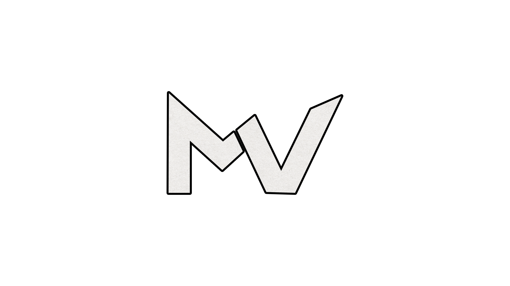

<div align="center">

  

  # MUSIC VIBE

  ### *Cinematic Ambient & Experimental Soundscapes*

  A bespoke, high-performance web experience at the intersection of music production and editorial luxury digital design.

  <br />

  <p align="center">
    <a href="https://music-vibe.vercel.app"></a>
    
    
    
    
    
    
  </p>

  <p align="center">
    <a href="#-the-vision">Vision</a> &nbsp;•&nbsp;
    <a href="#-experience-pillars">Pillars</a> &nbsp;•&nbsp;
    <a href="#-architecture">Architecture</a> &nbsp;•&nbsp;
    <a href="#-component-catalog">Components</a> &nbsp;•&nbsp;
    <a href="#-headless-content-management">Content CMS</a> &nbsp;•&nbsp;
    <a href="#-quick-start">Quick Start</a> &nbsp;•&nbsp;
    <a href="#-deployment--automation">Deployment</a>
  </p>

</div>

---

## ✦ The Vision

**Music Vibe** is not a standard promotional website—it is an atmospheric audio-visual landscape engineered for electronic, ambient, and experimental artists. Built around a **"Cinematic Dark × Editorial Brutalism"** design system, every pixel, shader, and interaction is choreographed to reflect the emotional frequency of the music.

---

## ◈ Experience Pillars

<table>
  <tr>
    <td width="50%" valign="top">
      <h3>🌌 Generative WebGL Ambience</h3>
      <p>Custom <code>FloatingLines</code> GPU shader canvas built with <b>Three.js</b>. Procedural geometric light waves drift organically across the viewport and distort dynamically in response to cursor velocity vectors.</p>
    </td>
    <td width="50%" valign="top">
      <h3>⚡ Tactile Acoustic Physics</h3>
      <p>From the cursor-reactive <code>ClickSpark</code> particle burst engine to the magnetic spring <code>Dock</code> and the multi-layered Hero ghost stroke with acoustic reverb echo, every touch feels physical.</p>
    </td>
  </tr>
  <tr>
    <td width="50%" valign="top">
      <h3>💿 3D Release Gallery</h3>
      <p>Interactive <code>GlareCard</code> surfaces featuring 3D gyroscopic tilt, specular light sheen, and individual HSL accent color signatures matching each release's cover artwork.</p>
    </td>
    <td width="50%" valign="top">
      <h3>🖋️ Editorial Brutalist Typography</h3>
      <p>Typographic performance driven by <b>Syne</b> and <b>Plus Jakarta Sans</b>, amplified with <code>DecryptedText</code> matrix-style cipher scrambles and split-word clip reveals.</p>
    </td>
  </tr>
  <tr>
    <td width="50%" valign="top">
      <h3>🔒 Asset & Identity Protection</h3>
      <p>Custom security layers disabling right-click context menus, image dragging, middle-click scraping, and developer inspection hooks to safeguard original audio-visual assets.</p>
    </td>
    <td width="50%" valign="top">
      <h3>🔄 Realtime Cloud Architecture</h3>
      <p>Powered by <b>Supabase</b> PostgreSQL with realtime channel sync, cloud storage artwork streaming, and automated serverless keep-alive cron jobs.</p>
    </td>
  </tr>
</table>

---

## ⬡ Architecture

The codebase adheres to a modular, high-performance React architecture with isolated components, headless data layers, and manual vendor chunking:

```
Music-Vibe-New-Site/
├── 📁 api/
│   └── keep-alive.js          # Vercel Serverless Function (Daily Supabase ping)
├── 📁 src/
│   ├── 📁 components/         # 15+ Micro-engineered UI primitives
│   │   ├── BorderGlow/        # Dynamic glowing border accent wrapper
│   │   ├── ClickSpark/        # Global canvas particle burst on click
│   │   ├── DecryptedText/     # Reconfigurable matrix letter-scramble
│   │   ├── Dock/              # MacOS-style magnetic floating navigation
│   │   ├── FloatingLines/     # Three.js generative shader background
│   │   ├── GlareCard/         # 3D tilt & dynamic specular release card
│   │   ├── LogoLoop/          # Infinite horizontal hardware-accelerated ticker
│   │   ├── PageTransition/    # Motion router transition orchestration
│   │   ├── ScrollReveal/      # Viewport intersection reveal wrapper
│   │   └── SocialLinks/       # Dynamic pill-style streaming links
│   ├── 📁 data/               # Headless JSON content layers
│   │   ├── tracks.json        # Release metadata, links & accent hues
│   │   ├── socials.json       # Streaming platforms & profile links
│   │   ├── friends.json       # Collaborator & collective network
│   │   └── socialIcons.jsx    # Pure SVG brand icon registry
│   ├── 📁 lib/                # Cloud SDK initialization (Supabase)
│   ├── 📁 pages/              # Route views (HomePage, MusicPage, About, Friends)
│   ├── 📁 styles/             # index.css (Design tokens, grain & animations)
│   ├── App.jsx                # Global shell, layout & protection listeners
│   └── main.jsx               # React 19 root mounting
├── 📁 public/                 # Static assets, logos & local artwork fallbacks
├── vercel.json                # Cron schedule & edge configuration
└── vite.config.js             # Manual vendor chunk splitting (Three, Motion, React)
```

---

## 🛠️ Technology Stack

| Layer | Technologies | Role & Purpose |
| :--- | :--- | :--- |
| **Core Framework** | `React 19` · `Vite 6` · `ESNext` | Ultrafast HMR, concurrent rendering & optimal hydration |
| **Animation & Physics** | `Motion v12` (`motion/react`) | Fluid spring physics, layout animations & scroll parallax |
| **3D & Creative Coding** | `Three.js` | WebGL canvas shaders & generative wave interference |
| **Styling & Tokens** | `Tailwind CSS v4` · Vanilla CSS | Design token architecture, brutalist typography & grain filters |
| **Style Utilities** | `clsx` · `tailwind-merge` · `cva` | Type-safe dynamic class variance & clean composition |
| **Cloud & Backend** | `Supabase` (PostgreSQL + Realtime) | Cloud artwork storage, realtime releases & profile data |
| **Infrastructure** | `Vercel` (Edge + Serverless Crons) | Global CDN distribution & automated DB keep-alive |

---

## 🧩 Component Catalog

| Component | Technology | Experience Description |
| :--- | :--- | :--- |
| `FloatingLines` | Three.js / WebGL | Generative vector line shader canvas that reacts to mouse velocity |
| `ClickSpark` | HTML5 Canvas | Emits radiant geometric spark particles at cursor click coordinates |
| `Dock` | Motion Spring Physics | Floating navigation dock with magnetic icon magnification |
| `GlareCard` | CSS 3D Transforms | 3D tilting card with realistic holographic light reflection |
| `DecryptedText` | React Animation Hooks | Scrambled cryptographic character reveal effect |
| `ScrollReveal` | IntersectionObserver | Smooth cinematic entry triggers for text & content strips |
| `LogoLoop` | CSS GPU Compositing | Seamless infinite marquee loop with zero jitter |
| `SocialLinks` | SVG Map / React | Dynamic brand pill links with platform-specific hover states |
| `PageTransition` | Motion AnimatePresence | Smooth cinematic cross-fades and slide transitions between pages |

---

## 🎧 Headless Content Management

The entire site is configured headlessly via `src/data/`, allowing seamless updates without altering core code.

### 📀 Adding or Modifying Releases (`tracks.json`)
```json
{
  "title": "Neon Dreams",
  "artwork": "neon-dreams.jpg",
  "link": "https://ffm.to/neondreams",
  "year": "2026",
  "type": "Single",
  "status": "Released",
  "accentColor": { "hue": 280, "sat": 85 }
}
```
> [!TIP]
> The `accentColor` object controls the dynamic glare gradient and aura emitted by the release's 3D card.

### 🤝 Updating Collaborators (`friends.json`)
Manage artist network, collaborative projects, roles, and direct streaming links displayed on the `/friends` page.

### 🌐 Socials & Streaming (`socials.json`)
Manage Spotify, Apple Music, YouTube, SoundCloud, Instagram, and BandLab links. Leaving any link string empty automatically removes the platform pill from the UI.

---

## 🚀 Quick Start

### Prerequisites
- Node.js `18.x` or higher
- npm, pnpm, or yarn

### 1. Clone & Install
```bash
git clone https://github.com/zishan049/Music-Vibe-New-Site.git
cd Music-Vibe-New-Site
npm install
```

### 2. Configure Environment
Create a `.env` file in the project root:
```env
VITE_SUPABASE_URL=https://your-project.supabase.co
VITE_SUPABASE_ANON_KEY=your-supabase-anon-key
```

### 3. Run Development Server
```bash
npm run dev
```
Open [http://localhost:3000](http://localhost:3000) in your browser.

### 4. Build for Production
```bash
npm run build
```
Optimized static bundles and vendor chunks will be output to `/dist`.

---

## ⚡ Deployment & Automation

The project is pre-configured for frictionless deployment on **Vercel**:

- **Edge CDN**: Automatic asset compression and instant global caching.
- **Serverless Keep-Alive (`/api/keep-alive`)**:
  Free-tier Supabase projects pause after inactivity. A daily Vercel Cron (`vercel.json`) invokes `/api/keep-alive` every day at `00:00 UTC` to perform an active database heartbeat ping:
  ```json
  {
    "crons": [
      {
        "path": "/api/keep-alive",
        "schedule": "0 0 * * *"
      }
    ]
  }
  ```

---

<div align="center">

  <sub>Crafted with obsessive attention to audio-visual harmony by <a href="https://github.com/zishan049"><b>@zishan049</b></a></sub>

  <br />

  <sub>© 2026 <b>Music Vibe</b>. All rights reserved.</sub>

</div>
